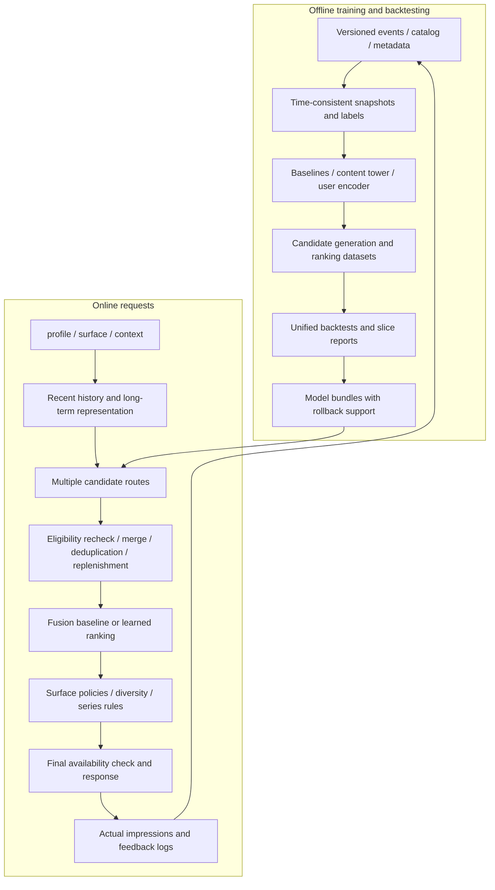

# Personal Recommender: architecture and algorithm plan v0.1

> Scope update, 2026-11-06: the initial use case is Disney Theatrical stage productions and musicals. [theatrical-plan.md](theatrical-plan.md) governs the initial implementation and data plan. The long-form video tasks, MovieLens path, and implementation sequence below remain references for extension research.

Date: 2026-11-06. Status: proposed design; effectiveness, performance, and compatibility require implementation and validation. Scope is limited to personal-recommender, independently of the brand project.

## 1. Product and success criteria

This document records the movie/TV and music extension paths. The current initial use case is Disney Theatrical; see the scope update. Each domain uses separate data, representations, labels, and consumption policies. The goal is a platform for comparing algorithms, replaying recommendations, and progressively serving real requests.

"Better" means improving the primary metric under the same temporal protocol, catalog, tuning budget, and resource budget, or substantially reducing cost with noninferior quality. Key slices, including new users and new content, must satisfy predefined constraints. This proposal is not a validated new state of the art.

| Surface | Initial objective | Key rules |
| --- | --- | --- |
| home_discovery | Discover relevant content in the eligible catalog | Control series repetition; configure seen-item policies by user intent |
| similar_items | Provide useful content related to a seed | Separate metadata, style, and behavior routes; retain provenance |
| continue_watching | Resume unfinished viewing | Require progress evidence; do not universally filter seen items |
| next_episode | Continue an ordered series | Respect series/season/episode structure, availability, and resume position |
| music_discovery, later | Music discovery and repeat listening | Configure labels and evaluation separately from movies |

Public rating data initially supports the first two tasks and sequential-ranking proxies. Without playback progress and impression logs, do not claim validation of the latter two video tasks, viewing satisfaction, or online retention.

## 2. Architecture: modular monolith and offline jobs



Logical modules do not imply separate microservices. Initially, data and inference components share a process, while training runs through separate commands. Slow media encoding and full training must not block requests. Start with exact retrieval for small catalogs; introduce ANN only when performance measurements justify it.

## 3. Data contracts

The project owns ID mappings, missing-value policies, and feature transformations. Upstream libraries consume adapted views.

| Object | Required fields / semantics |
| --- | --- |
| CatalogItem | item_id, domain, content type, release time, availability windows, language, series structure, metadata_version |
| InteractionEvent | event_id, profile_id, item_id, event_type, event_time, available_at; optional session, position, intentional/autoplay status, progress |
| RecommendationRequest | request_id, profile_id, surface, time, context, eligible catalog/authorization context version, experiment assignment |
| ExposureEvent | request_id, actually visible item, position, time; record probabilities when a known random mechanism exists, without inventing propensities |
| LabelSpec | Label definition, observation window, maturity rules, relevance definition, missingness mask, version |
| TaskSpec | Surface, domain, history construction, candidate eligibility, repeat-consumption rules, metrics, K |
| ExperimentManifest | Data hash, cutoff, label/feature/model configurations, code SHA, dependencies, seeds, hardware, budgets |

`event_time` records when an event happened; `available_at` records when the system could know it. Historical replay must respect both. Duration observed after viewing cannot be an input to that request; mature historical duration can inform later requests.

Represent title/series/season/episode levels separately so that an arbitrary-ID model's next-episode behavior is not mistaken for general discovery. Keep unexposed content, unclicked impressions, explicit dislikes, and incomplete observation windows distinct.

## 4. Modules and proposed layout

```text
src/personal_recommender/
  contracts/       # TaskSpec, events, candidates, model bundle interfaces
  data/            # ingestion, catalog, snapshots, labels, id maps
  features/        # metadata, text, media, as-of transformations
  models/
    baselines/     # popular, itemknn, ALS/BPR, EASE, VAE adapters
    encoders/      # content, long_history, short_history
    retrieval/     # exact, later ANN, multi-route merging
    ranking/       # RRF, simple supervised models, later multitask
  policies/        # surface eligibility, repeat, series, diversity
  evaluation/      # temporal replay, metrics, slices, uncertainty
  training/        # samplers, losses, trainer adapters
  serving/         # inference pipeline, API, fallback, model loading
  experiments/     # manifests, reports, artifact registry
configs/
  tasks/ models/ experiments/
tests/
  data/ evaluation/ models/ serving/
docs/
```

This is a planned layout; do not create empty implementations at this stage. Core boundaries: CandidateGenerator returns item, route, route_rank, and route_score; Ranker consumes unified candidate features; Policy handles hard rules independently; Evaluator does not invoke upstream default splits. Tests prioritize leakage, metrics, numerical comparisons, rules, and replay rather than mirroring every simple wrapper.

## 5. Stack and deployment boundaries

- Initial candidates: Python 3.11; Parquet + DuckDB for traceable local snapshots and backtests; PyTorch for learned models; RecTools as the preferred adapter, with RecBole cross-reproduction only in isolation. Lock versions after a compatibility spike.
- Serving: wrap inference with FastAPI after models stabilize. Kafka, Kubernetes, a separate online feature store, and GPU-specific indexes are unnecessary for the initial version.
- Manage history and model files locally first. Choose a separate state store when real traffic requires cross-request state. Precompute embeddings in batches, update recent user state per request, and determine retraining cadence through freshness ablations.
- A local CPU path must run. Validate MPS/CUDA separately. HSTU custom GPU operators are not required for the local demo.

References: [RecTools](https://github.com/MTSWebServices/RecTools), [DuckDB Parquet](https://duckdb.org/docs/stable/data/parquet/overview), [PyTorch MPS](https://docs.pytorch.org/docs/stable/notes/mps.html), [FastAPI](https://fastapi.tiangolo.com/).

## 6. Core algorithm: content path with an optional ID residual

The goal is to use collaborative signals for existing content while representing new content from information available before release. This is a proposed combination for the project, without a claim of first invention.

Let c_i denote a content representation, r_i a trained ID residual, and n_i the interaction support permitted by the model snapshot:

\[
c_i=f_{content}(metadata_i,text_i,media_i,masks_i),\quad
e_i=\operatorname{norm}(c_i+\rho(n_i)r_i),\quad \rho(0)=0.
\]

Initially, c_i uses only metadata and text. Add visual and audio inputs through separate ablations. Start rho with a fixed monotonic support function and validate thresholds before considering a learned gate. n_i must exclude interactions after the training cutoff. Disable untrained ID residuals rather than manufacturing personalization from random new-ID vectors.

During training, randomly mask the ID path for sufficiently supported items so that the content path participates in the task. Evaluate content-only, ID-only, and hybrid variants separately. Represent missing media with explicit masks rather than interpreting a zero vector as semantic content. ID-dropout is a training hypothesis to validate, not a guarantee of better cold start.

Start with fixed text representations and a lightweight projection. Keep the text encoder off the online request's critical path. Record external pretrained models' knowledge time boundaries separately.

## 7. User encoding: long-term interests and current intent

\[
u_L=\operatorname{Pool}_{long}(e_{i_1},\ldots,e_{i_m},time,event),\quad
u_S=f_{causal}(e_{i_{t-k}},\ldots,e_{i_t},\Delta t,event),
\]
\[
u=\operatorname{norm}(g(H,c_t)u_L+(1-g(H,c_t))u_S).
\]

Start long-history encoding with time-decayed pooling as an interpretable control. Start short-history encoding with standard SASRec, then add actual time gaps and event types. The request-level scalar/vector gate g depends only on context available at the time. Initially fix it or define it by history length, then compare a learned gate.

Use available content for short histories. With no history, use explicit user selections, seed content, or priors conditioned on surface/language. Do not invent uncollected preferences. The default unit is a profile. Study household viewing through explicit modes or feedback rather than forcing shared accounts into inferred identities.

Initial experimental settings: embedding size 128, sequence limit 100, 2 layers, 4 heads. Then compare 64/128 dimensions and 100/200 sequence lengths. Reduce parameters when compute is insufficient; do not weaken baseline training budgets to create an advantage for the new model.

Retrieval uses the inner product s(u,i)=u^T e_i/tau. Request-level gating and offline item vectors keep exact/ANN retrieval feasible. If later user gating depends on the candidate, put it in post-retrieval ranking rather than assuming a single user vector still exactly represents retrieval scores for all items.

## 8. Objectives and negative sampling

Sequential learning initially predicts the next eligible target. At the MovieLens stage, explicit rating thresholds can create implicit proxy labels, but these must not be described as viewing satisfaction.

Compare sampled BCE, BPR, and sampled softmax first. Under an appropriate sampling protocol:

\[
\mathcal L_{ret}=-\log\frac{\exp(s(u,i^+)-\log q(i^+))}{\sum_{j\in S}\exp(s(u,j)-\log q(j))}.
\]

Handle duplicate items, multiple positives, in-batch sampling probabilities, and known ineligible candidates correctly. logQ corrects sampling, not exposure. Start with uniform/in-batch negative mixtures. Try hard negatives only after basic convergence, and measure sensitivity to false negatives.

Do not initially combine distillation, contrastive learning, reconstruction, and RL. Prioritize module dropout and input ablations to validate the main task. Add extra losses one at a time and record their weights separately.

## 9. Multiple candidate routes and ranking

Candidate sources include behavioral similarity/ALS, content similarity, sequence or hybrid encoders, conditional popularity, and exploration once real experimentation is possible. Generate each route within eligible catalog constraints, then merge and recheck. Use bounded replenishment queries when candidates are insufficient.

Start fusion with Reciprocal Rank Fusion: RRF(i)=sum_r 1/(k0+rank_r(i)). Do not directly add incomparable raw model scores. Initial settings of 100 candidates per route, approximately 500 after merging, and 20 returned items are adjustable experiment configurations, not performance promises.

Upgrade ranking in three stages:

1. Without impression logs: use RRF and post-retrieval next-item ranking as research controls. A simple reranker may use out-of-fold or out-of-time candidates, explicitly as an implicit-preference proxy.
2. With requests and mature feedback: estimate qualified starts, quick exits, continued consumption, or explicit satisfaction separately. Begin with independent models/shared MLP, then try MMoE. Training-loss weights are not business-utility weights.
3. With reliable online validation: select calibrated utility by surface, then compare list or page models. Define each head's denominator and observation window explicitly; do not mix unconditional and conditional probabilities.

Generate ranking-training candidates using out-of-fold or out-of-time models to avoid stacking leakage from a model scoring positives it has seen. Assess candidate coverage through overall retrieval outcomes. Fixed candidates isolate reranker effects; report these two experiments separately.

## 10. List policies and exploration

Hard constraints include region, licensing, age mode, availability windows, blocks, and episode order. Soft objectives include relevance, series concentration, freshness, and diversity. Hard constraints take precedence; a high score cannot compensate for ineligibility.

Start with interpretable series caps and MMR controls. Log deduplication, filtering, and replenishment reasons. Fix the representation used for similarity as well, so diversity gains are not defined circularly by the main model's own embedding.

Without a real impression pipeline, implement exploration interfaces and simulations only; do not claim calibration gains. Before launch, log valid assignment probabilities and coverage, then compare limited-budget random exploration or bandits. Model prediction variance is not automatically reliable epistemic uncertainty.

## 11. Replay, release, and fallback

An immutable bundle should bind the model/encoder, ID mappings, embeddings, retrieval index, feature schema, calibrators, task policies, training manifest, and evaluation report. Use current catalog authorization state and check it before returning results; a fixed model bundle does not justify ignoring removals.

Run offline replay and shadow requests before atomically switching models. On failure, roll back to the previous compatible bundle. Do not mix new item embeddings with an old index. If semantic content processing fails, use a weaker available representation. If inference times out, use conditional popularity or a validated baseline. All fallbacks still apply hard filters. Return an explicit empty result when nothing is eligible rather than filling with invalid content.

## 12. Evaluation and release gates

The primary protocol uses global train/validation/test time boundaries and successive next-item replay, with consistent validation/test rules. During testing, history state may update from arrived events. Future labels cannot flow back into training unless a separate replay follows predefined retraining times.

| Layer | Metrics |
| --- | --- |
| Candidates | Eligible-catalog Recall@K, unique hits per route, cold-content coverage, insufficient-candidate rate |
| Retrieval implementation | ANN recall relative to exact retrieval, memory, update cost |
| Ranking / lists | NDCG@K, Recall@K, series repetition, coverage/concentration, diversity |
| Probability / product | Calibration, quick exits, qualified starts, satisfaction; only with the corresponding data |
| Engineering | Full-pipeline p50/p95/p99, memory, throughput, training/request cost, fallback rate |

Primary slices include zero/short-history and active users; zero/few-interaction content; language; series/standalone titles; and surface. Compute paired confidence intervals at an appropriate independent unit such as profile. After configuration search, lock the design and run one primary test. Use multiple seeds for robustness rather than reporting only the best seed.

Release conditions: zero hard-constraint test violations, consistent replay, traceable data/models, and a preregistered primary-metric improvement over a selected strong baseline, or noninferior quality with lower cost. Determine minimum effects and slice noninferiority margins from E1 pilot variance and business tradeoffs, then freeze them before the primary test. Set latency budgets from E1 measurements on fixed hardware and catalog size rather than promising arbitrary millisecond targets.

## 13. Sequence and risks

E0 Data and replay → E1 Strong baselines → E2 Content/sequence/fusion factorial experiments → E3 Cold-start hybrid → E4 Serving and real logs → E5 Multitask/exploration → E6 HSTU/generative or page experiments.

Priority risks: missing impression/progress logs prevent full product evaluation; ID shortcuts may suppress the content path; sequences may learn only within-series continuation; semantic spaces may not transfer across domains; pretrained knowledge may contaminate historical backtests; offline gains may not translate online.

Initial unresolved inputs: available data and permitted materials, catalog scale, target hardware/budget, and access to online experimentation. Retain public-data research and real-log paths, choosing implementation steps based on evidence.

## 14. Relationship to the literature

For content/behavior representations, context, and incremental updates, see [Netflix Foundation Model](https://netflixtechblog.com/foundation-model-for-personalized-recommendation-1a0bd8e02d39). For temporal splitting, see [Time to Split](https://arxiv.org/abs/2507.16289). The gating, module boundaries, implementation sequence, and acceptance criteria here are project proposals; these references are not claimed to use the same combination.

Standard SASRec is an interpretable starting point; eSASRec and HSTU are challengers. Retain LiGR's withdrawal status in the research record and do not base this proposal on its original industrial performance claims. [Status record](https://arxiv.org/abs/2502.03417)
