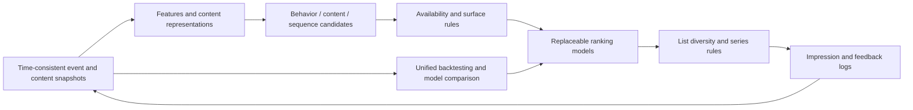

# Experiment roadmap and architecture recommendations

> Scope update, 2026-11-06: the initial use case is Disney Theatrical stage productions and musicals. [theatrical-plan.md](theatrical-plan.md) governs the initial implementation and data plan. The long-form video tasks, MovieLens path, and implementation sequence below remain references for extension research.

Status at drafting: research proposal; no training environment had been installed and no benchmark had been run. Prioritize validation of the personal recommendation project, independently of the brand project.

## 1. Initial framework

RecTools is the preferred candidate for comparing traditional models, SASRec, eSASRec, and HSTU within one framework. Use RecBole for broader model coverage and implementation cross-checks, with isolated environments and result adapters. Do not place the two frameworks' default outputs directly into one leaderboard.

Retain project-owned data contracts, temporal splits, candidate eligibility, evaluation, and experiment manifests. Integrate upstream models through adapters so that no library's default splitting or ID mapping defines the project. Resolve Python and dependency versions during installation. Validate Mac CPU/MPS separately from Linux CUDA experiments; GPU-specific operators are not assumed to work on Mac.

## 2. Data and tasks

| Available data | What can be validated | What the data cannot establish |
| --- | --- | --- |
| Stable MovieLens 1M/20M/32M release | Ranking with implicit labels derived from ratings, temporal methods, baseline reproduction | Actual impression CTR, autoplay, viewing duration, or online retention |
| Metadata and legally usable media | Similarity, content cold start, representation ablations | A visual style necessarily improves satisfaction |
| Profile-level requests, impressions, playback, and feedback logs | Homepage and session tasks, time-consistent replay | Policy incrementality without experimentation |
| Appropriately licensed music behavior | Repeat listening, skips, playlists | Direct reuse of movie labels and thresholds |

MovieLens distinguishes stable research releases from the changing latest dataset. Handle data usage terms separately from code licenses. [GroupLens](https://grouplens.org/datasets/movielens/)

## 3. Experiment ladder

| Stage | Required controls | Criteria for progression |
| --- | --- | --- |
| E0 Data protocol | Popularity, random sanity check, content similarity | Replay one request without future-feature or catalog leakage |
| E1 Static interests | SAR/ItemKNN, implicit ALS/BPR, EASE, Multi-VAE/RecVAE | Complete reports under the same protocol and tuning budget, including costs |
| E2 Ordered behavior | SASRec original loss vs sampled softmax on the same candidates; eSASRec module ablations | Attribute gains to sequence or training choices while meeting resource budgets |
| E3 New content | ID-only vs content-only vs hybrid; add text/visual/audio incrementally | Effective zero-interaction slices with pretrained-knowledge leakage controlled |
| E4 Product ranking | Single objective vs multitask; independent ranking vs diversified reranking | Satisfaction proxies, calibration, and latency all meet requirements |
| E5 Frontier methods | HSTU, Semantic-ID retrieval, page modeling | Beat strong baselines under the same loss/budget while supporting catalog maintenance and rollback |
| E6 Online | Small-traffic controlled tests and exploration | Define primary metrics, guardrails, sample size, and duration in advance |

Do not assume greater complexity wins at any stage. Report means, uncertainty, seeds, and training/inference costs. Compute paired intervals by profile or another appropriate independent unit rather than treating one person's repeated events as independent samples.

## 4. Initial logical architecture

These are logical responsibilities, not mandatory microservices. Exact full-catalog retrieval can reduce complexity for small catalogs; introduce ANN only after measurements justify it. Apply availability constraints before retrieval where appropriate and recheck afterward to avoid insufficient candidates after filtering.

## 5. Required experiment records

Save the task and surface, data source and license, time boundaries, ID mappings, content eligibility rules, positive/negative definitions, repeat-consumption rules, label maturity windows, candidate construction, tuning budget, seeds, code/model/feature versions, dependency lockfile, hardware, peak memory, training duration, end-to-end tail latency, and metric slices.

Cover retrieval, ranking, lists, calibration, satisfaction proxies, and resources separately. Do not enable a universal `filter_seen` rule for Continue Watching, children's repeat viewing, and music replay. Next-episode metrics must distinguish within-series continuation from cross-series discovery.

## 6. Priority research hypotheses

1. Content hybrids improve retrieval for new content without harming preferences for existing content.
2. Time and session information add value after controlling for the original sequence loss.
3. Visual/audio inputs add value after controlling for text and metadata.
4. Better qualified-start rankings do not achieve apparent gains by worsening quick exits, repetition, or satisfaction.
5. HSTU/generative gains reproduce under equal budgets rather than only beating weakly configured baselines.
